# Architecture: Northwind Insurance support copilot

Template: `playbook/design/architecture-summary.md`. The production picture is Figure E.1 in Appendix E; this is the
capstone's version, with the module that enforces each control.

## Diagram

```mermaid
flowchart LR
  A[Adjuster desktop<br/>web/answer_view.ts] -- B1: bearer token --> API[app.py /v1/ask]
  API --> R[intent.py router]
  R -- claim_status / speak_to_human --> OUT[response, no model call]
  R -- policy_question --> P[pii.py redact]
  P --> S[tenancy.py PermissionAwareRetriever<br/>ACL filter before ranking]
  IDX[(index: ingest.sync_corpus<br/>policies + platform docs + acl.json)] -- B2 --> S
  S -- weak coverage or no principal --> ABS[abstain]
  S --> BUD[answer.py budget: trim sources to $0.02]
  BUD -- B3: redacted prompt only --> M[model]
  M --> C[validate citations] --> G[guard.py] --> RS[pii.py restore] --> OUT
  OUT -. proposed tool call .-> T[tools.py open_claim_review<br/>budget, authz, idempotency, approval]
  T -- B4 --> CL[(claims system)]
  T --> AUD[(audit log)]
```

## Components
| Module | Owns |
|---|---|
| `ingest.py` | Heading-aware chunks; `sync_corpus` re-chunks only changed documents and blocks empty exports |
| `tenancy.py` | Principals, ACLs, `can_read` (fail closed) and the permission-aware retriever |
| `retrieval.py` | Hybrid BM25 and vector search with RRF; coverage for abstention |
| `intent.py`, `pii.py`, `guard.py` | Routing, redaction and restore, output guardrails |
| `answer.py` | The request path, the per-question budget, bounded retries and degraded modes |
| `tools.py` | The one consequential tool and its controls |
| `evals.py`, `loadmodel.py` | Golden set, security probes, the deterministic load model |
| `slo.py`, `golive.py`, `build.py` | SLO and canary, the go/no-go computation, the v0 and remediated builds |

## Trust boundaries
| Boundary | What crosses it | Control | Test that proves it |
|---|---|---|---|
| B1 · Desktop to API | Questions, answers | Bearer token, input limits, escaped rendering | `test_http_api`, `test_answer_view_widget` |
| B2 · Sources to index | Documents from other teams and tenants | ACL copied at ingestion; filter before ranking; no ACL means invisible | `test_cross_tenant_chunks_never_retrieved`, `test_restricted_groups_and_missing_acl_fail_closed` |
| B3 · Service to model | Prompts | Redaction first; only the caller's permitted chunks | `test_pii_never_reaches_model`, `test_copilot_without_principal_fails_closed` |
| B4 · Tool to claims system | Review requests | Caller's identity, never the model's; supervisor approval; budget | `test_c1_agent_tools.py` |

## Degraded modes
| Fault | Behavior | Test |
|---|---|---|
| Model timeout | One retry, then retrieval-only: the cited sections, no generated answer | `test_model_timeout_retries_once_then_degrades` |
| Index unavailable | Escalate to an agent; the model is never called without sources | `test_retrieval_outage_escalates_without_model_call` |
| Broken document export | Refresh blocked for that document; the previous version keeps serving | `test_sync_blocks_empty_document_and_keeps_previous` |
| Tool loop | Stops at the execution budget | `test_execution_budget_stops_runaway_tool_calls` |
